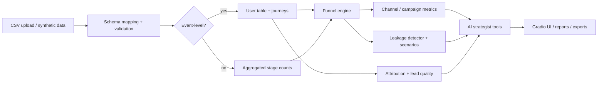

# JOURNEY / AI
Find the leaks. Fix the journey. Grow revenue.

## Overview
An interactive analytics app that traces the customer journey from campaign exposure through leads, qualification, opportunities, conversion and revenue, and shows where the funnel loses value. Bundled data is **fictional synthetic data**.

## Business problem and objectives
Management sees high lead volume but weak revenue growth. The app answers: which channels give leads and paying customers, where the biggest drop-off is, which campaigns attract low-quality leads, how much modeled revenue is associated with leakage, what to fix first, and how to measure improvement.

## Key features
Configurable funnel (closed/open, windows, stage rename/reorder/disable), channel and campaign intelligence, lead quality and optional model, journey and attribution (first, last, linear, position, time-decay, Markov), revenue leakage detector, AI strategist with deterministic fallback, scenario simulator, data quality page, HTML report and CSV exports, built-in tests.

## Screenshots
Add your own screenshots to `screenshots/` (see `screenshots/README.md`). None are included.

## Architecture


## Technology stack
Python, Gradio, Plotly, pandas, NumPy, scikit-learn.

## Installation and execution
```
pip install -r requirements.txt
python app.py
```
In Google Colab, paste `app.py` into one cell and run it.

## Sample dataset schema
`sample_data.csv` (events): timestamp, visitor_id, event_name, channel, campaign, deal_value, refunds, lead_score, industry, company_size. `sample_costs.csv`: campaign, channel, campaign_cost, clicks, impressions. Aggregated files need channel/campaign plus stage counts (visits, leads, mql, sql, opportunities, closed_won, revenue, spend).

## Funnel definitions and formulas
Conversion = stage count / previous stage; cumulative = stage / first stage; drop-off = previous - stage. Closed funnel = sequential within the window; open = any occurrence. Value at stake = drop x downstream win rate x average deal value (upper bound).

## Attribution methodology
First, last, linear, position-based (40/20/40), time-decay (half-life) and Markov removal effect. Credits reconcile to total conversions and revenue. Attribution is not causal impact.

## Scenario calculation methodology
Improve a stage conversion by x percentage points; downstream conditional rates stay at baseline; wins = leads x product of rates; revenue = wins x average deal value x (1 + change); contribution = revenue x assumed margin. Modeled, not a forecast.

## Testing
`pip install pytest && pytest tests` runs the same checks the app shows on start-up.

## Deployment
Run locally, in Colab, or deploy `app.py` to a Hugging Face Space (SDK: Gradio). Publishing is manual and needs your own credentials.

## Data privacy
Use pseudonymous IDs. Never commit real customer data or API keys. Keys entered in the app stay in the session.

## Limitations and future enhancements
Attribution is not causal; scenarios need experiments to validate; aggregated data cannot show journeys. Future: incrementality tests, CRM connectors, time-to-convert curves.
